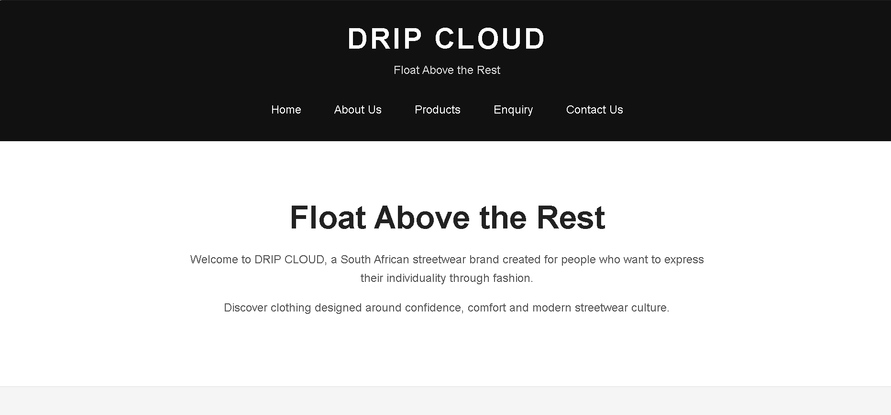
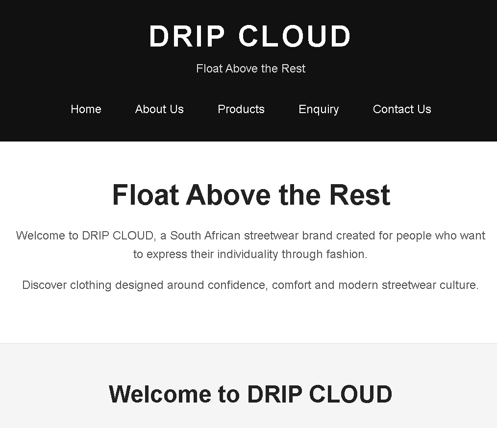
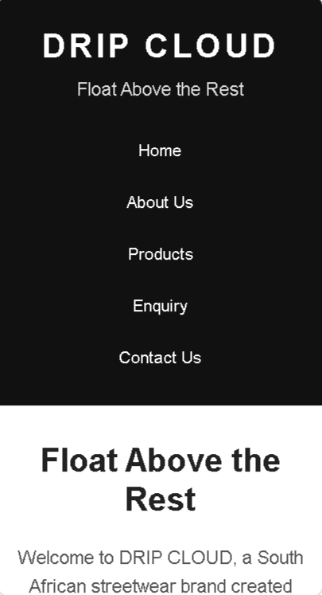

# Drip Cloud Website Project

**Project:** Drip Cloud E-Commerce Website  
**Course:** Web Development (WEDE5020)  
**Student:** Vincent Jonas  
**Student number:** ST10503108

## Project Overview

Drip Cloud is a South African streetwear brand website developed as part of the Web Development coursework. The website introduces the brand and provides information about its products, enquiries and contact details. It is a multi-page website built with HTML and CSS, with responsive layouts for desktop, tablet and mobile screens.

## Website Goals

- Present the Drip Cloud brand and its products.
- Help visitors navigate the website and find product and contact information.
- Let visitors make product enquiries and contact the organisation.
- Provide a consistent, responsive experience across screen sizes.

## Website Pages and Features

- **Home:** Introduces the brand and links to key pages.
- **About Us:** Presents the brand story, mission, vision and values.
- **Products:** Displays products, descriptions and prices.
- **Enquiry:** Provides a form for product enquiries.
- **Contact Us:** Provides contact details and a map.
- **Thank You:** Confirms an enquiry and offers links to continue browsing.
- Shared navigation and external CSS styling across the website pages.
- Responsive layouts, product images, forms, and hover and focus styles.

## Repository Structure


```text
DripCloud-website/
├── index.html           # Home page
├── pages/               # About, Products, Enquiry, Contact and Thank You pages
├── css/                 # Shared stylesheets
├── js/                  # JavaScript files, when used
├── image/               # Website and product images
├── wireframes/          # Planning wireframes
├── screenshots/         # Desktop, tablet and mobile evidence for this README
├── CHANGELOG.md         # Record of project development
└── README.md            # Project information and instructions
```

## Technologies and Tools

- HTML5 and CSS3
- JavaScript, where implemented
- Visual Studio Code and Live Server
- Git and GitHub
- Responsive Web Design

## Design, Responsiveness and Accessibility

The site uses a streetwear-inspired style with dark headers and footers, light content areas, and high-contrast text. The shared stylesheet controls typography, colour, spacing, navigation, buttons, product cards, forms, images and page layouts. Responsive breakpoints adapt the navigation, product grids, typography, images, map and page spacing to smaller screens.

The pages use semantic elements such as `header`, `nav`, `main`, `section` and `footer`. Images should have useful alternative text, and form controls should have visible labels and appropriate validation. Check these details on every page as the site is updated.

## Responsive Website Screenshots

Add the three actual screenshot files to the repository at the paths below. Then confirm they display on the GitHub README page.

### Desktop



### Tablet



### Mobile



## Part 1 Feedback and Improvements

**Feedback received:** The Part 1 submission was a ZIP file. The marker advised me to follow the submission instructions and stated that zipped folders would not be accepted.

**Action for Part 2:** The Part 2 submission included the GitHub repository link and the deployed website link.

**Action for Part 3:** Push the completed website and README updates to the GitHub repository, then submit the repository link and deployed website link through the LMS. Do not submit the website as a ZIP file.

## Part 2 Improvements

Part 2 focused on CSS styling and responsive design. The recorded updates include:

- Updated and linked the external stylesheet across the website pages.
- Added default styles, typography, layout, colour and decoration.
- Added hover, focus and active pseudo-classes.
- Added tablet, mobile and small-screen breakpoints.
- Improved responsive navigation, product images, product grids, typography and contact map styling.
- Removed unnecessary inline styling and improved the Thank You page layout.
- Recorded Part 1 feedback improvements in `CHANGELOG.md`.

## Part 3 Progress

Update this section as work is completed. Do not mark an item complete until it has been implemented and checked on the deployed site.

- [ ] Record and implement any corrections from Part 2 marker feedback.
- [ ] Implement and verify JavaScript interactive elements.
- [ ] Implement and verify the interactive map and gallery lightbox.
- [ ] Implement dynamic product content and product search/filtering.
- [ ] Add page-specific SEO titles, descriptions, keywords, image names and alt text.
- [ ] Add and check `robots.txt` and `sitemap.xml`.
- [ ] Complete enquiry form controls, validation and relevant response.
- [ ] Complete contact form controls, validation and email process.
- [ ] Deploy the site and check every page and feature.
- [ ] Add final desktop, tablet and mobile screenshots above.
- [ ] Update references and changelog; push descriptive commits.

## GitHub and Deployment

- **Repository:** https://github.com/vincentjonas065/DripCloud-website
- **Deployed website:** Add the current public deployment URL here before submitting.

## How to Run Locally

1. Clone the repository:

```bash
git clone https://github.com/vincentjonas065/DripCloud-website.git
```

2. Open the project folder in Visual Studio Code.
3. Open `index.html` with Live Server or in a modern web browser.

## References

CYR, D., 2008. Modeling web site design across cultures: perspectives from Latin America, Europe, and the United States. *Journal of the Association for Information Systems*, 9(8), pp.439–465.

GARRETT, J.J., 2002. *The Elements of User Experience: User-Centered Design for the Web*. New Riders.

INTERACTION DESIGN FOUNDATION, 2026. *E-commerce UI/UX: Best Practices for Online Stores* [online]. Available at: https://www.interaction-design.org/literature/article/e-commerce-ui-ux [Accessed 5 August 2026].

MDN WEB DOCS, 2026. *HTML: HyperText Markup Language* [online]. Available at: https://developer.mozilla.org/en-US/docs/Web/HTML [Accessed 5 August 2026].

NIELSEN NORMAN GROUP, 2025. *E-commerce User Experience* [online]. Available at: https://www.nngroup.com/articles/e-commerce-usability/ [Accessed 5 August 2026].

PALMER, J.W., 2002. Web site usability, design and performance metrics. *Information Systems Research*, 13(2), pp.151–167.

ROBINS, D. and HOLMES, J., 2008. Aesthetics and credibility in web site design. *Information Processing & Management*, 44(1), pp.386–399.

WORLD WIDE WEB CONSORTIUM (W3C), 2026. *Web Content Accessibility Guidelines (WCAG) 2.2* [online]. Available at: https://www.w3.org/TR/WCAG22/ [Accessed 5 August 2026].

W3SCHOOLS, 2026. *HTML5 Semantic Elements* [online]. Available at: https://www.w3schools.com/html/html5_semantic_elements.asp [Accessed 5 August 2026].

Add references for any new research, images, code or external services used in Part 3, following the Harvard Style Referencing Guide adapted for the IIE. Include AI use in the required format if applicable.
